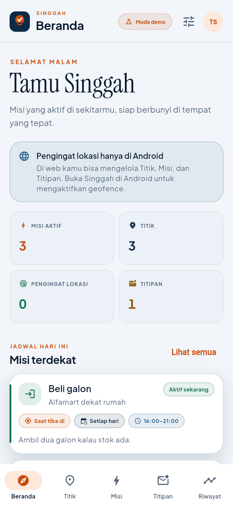
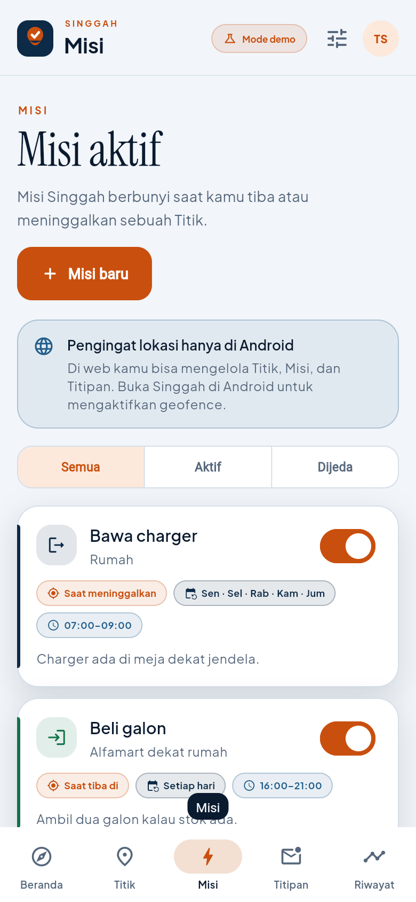
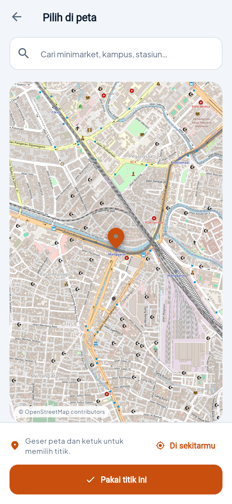
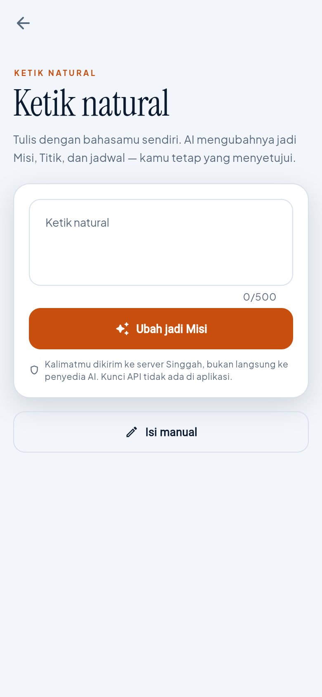
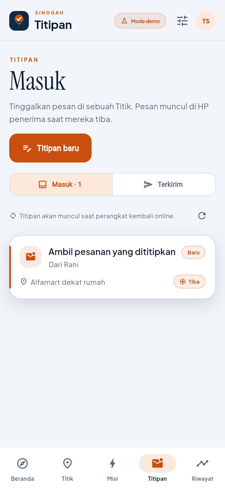
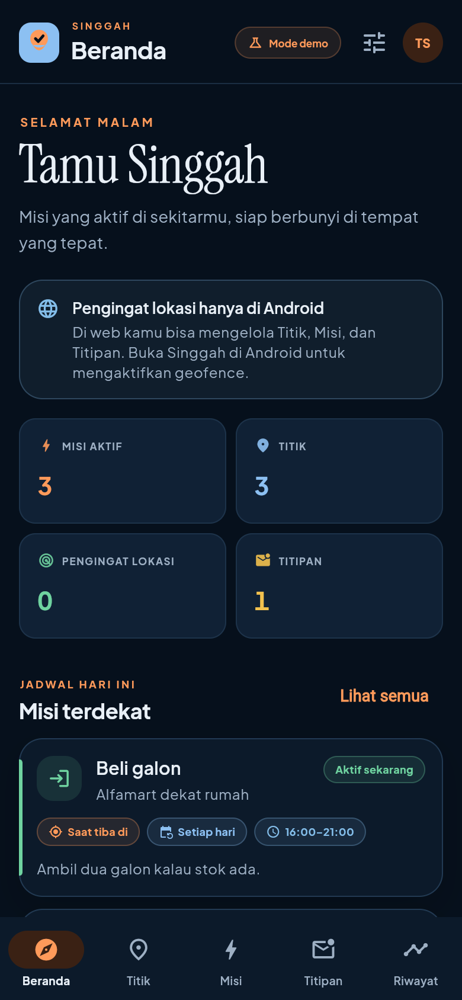
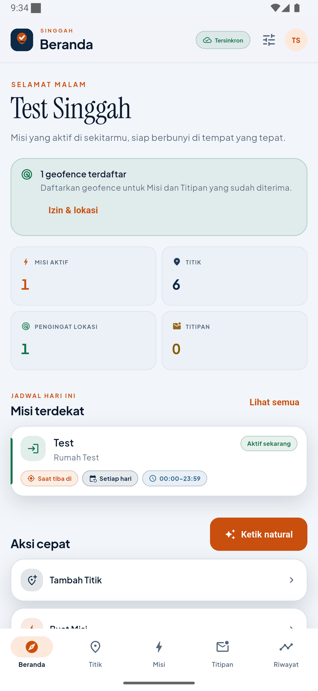
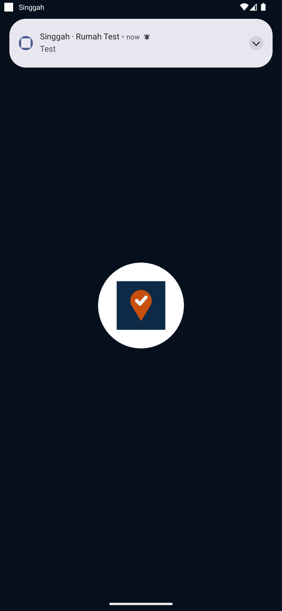
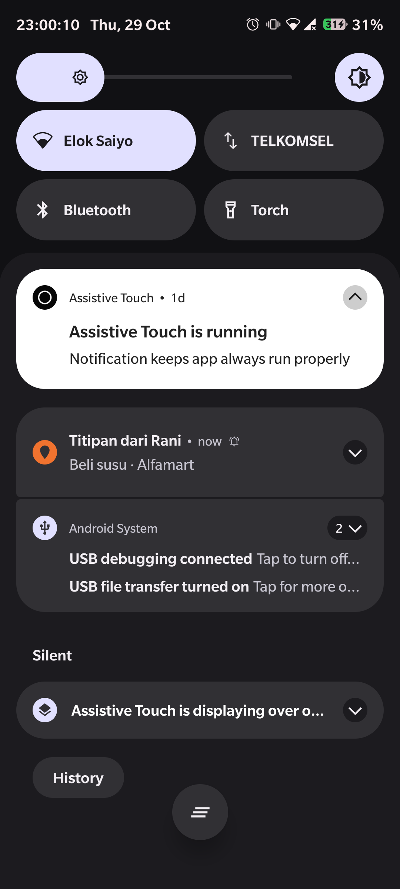

# Singgah

> **Diingetin pas di tempatnya, bukan pas lupa.**
> Reminded right where it matters, not when you forget.

Singgah is a local-first Flutter app for Android and Web. You save the places you
know as **Titik**, attach **Misi** (place-triggered reminders), and leave
**Titipan** (notes that appear for someone when they reach a place). Android
native geofences do the waking-up; the web app manages the same data and explains
why live triggers are Android-only.

[](https://github.com/MTegarPamungkas/singgah/actions/workflows/ci.yml)
[](https://github.com/MTegarPamungkas/singgah/actions/workflows/cd.yml)
[](#testing)
[](https://flutter.dev)

> The release badge goes live after the first `v*` tag is pushed.

## Screenshots

| Home | Missions | Place picker |
| --- | --- | --- |
|  |  |  |

| Natural input | Titipan | Dark mode |
| --- | --- | --- |
|  |  |  |

| Android home (Appwrite sync) | Geofence notification | FCM push |
| --- | --- | --- |
|  |  |  |

## Build plan

1. **Foundation** — Flutter shell, design tokens, ID/EN, Hive store, auth, DI,
   routing, demo mode.
2. **Core loop** — Titik editor/map search, Misi editor, schedule evaluation,
   geofence planning, native Android registration, history.
3. **Titipan** — invite tokens, row-level permissions, realtime inbox, local
   notifications.
4. **AI and extras** — Appwrite Function parsing, review UI, biometric lock, dark
   mode, permissions onboarding, sync/outbox hardening.
5. **Delivery** — unit/bloc/widget tests, core coverage gate, CI artifacts,
   tag-based release/deploy, documentation.

## Why Singgah

Most reminder apps fire at a time, not at a place. Singgah flips that: a mission
belongs to a Place and fires on arrival or departure, inside the days and hours
you choose. The app is deliberately quiet about location: it never tracks a
route, never shares live position, and keeps arrival history on the device.

## Features

### Accounts and continuity

- Email/password and (when configured) Google sign-in through Appwrite Auth.
- Profile with display name and avatar.
- Cloud sync with offline-first local storage and a durable outbox.
- Demo mode when Appwrite is not configured; clearly labelled local-only data.
- Biometric app lock on Android, dark/light/system theme, Indonesian/English.

### Titik (Places)

- Map selection plus free OpenStreetMap search through a cached backend proxy.
- Radius editor (100–2000 m), icon and color metadata.
- Geofence-ready validation and graceful handling of low GPS accuracy.

### Misi (Missions)

- Arrive **or** leave trigger, per-place.
- Repeat days (every day, weekdays, weekends, or custom ISO days).
- Time windows, including overnight windows.
- Active/paused state; paused missions are never registered with Android.
- Clear schedule/status labels: active now, outside window, not today, paused.
- Android geofence budget planner (default cap 90) keeps the nearest/most
  relevant missions registered and re-plans after meaningful movement.

### Titipan (Notes)

- Leave a message at a Place for someone else.
- Share a deep-link invite; the recipient accepts it on their own account.
- Inbox/sent views, unread badges, realtime refresh while Appwrite is connected.
- Row-level permissions: only the sender and recipients who accepted can read a
  note.
- Invite acceptance is idempotent and validated by the `accept-titipan` Function.
- Local notifications cover in-app arrivals, and Appwrite Messaging pushes a
  Titipan to every registered device when an invite is accepted.
- Add friends by email (request + approval), remove friends, create private groups,
  add/remove members, promote co-admins, and send a Titipan directly to a friend
  or group without sharing a link.
- Realtime chat for each friendship and group, with a message window that updates
  without refreshing.

### Ketik Natural (AI)

- Free-form sentence to a reviewed draft: title, Place, trigger, days, window.
- Runs only through the `parse-reminder` Appwrite Function; no AI key in the app.
- Model fallback chain (`gemini-3.6-flash` → `gemini-3.5-flash`) avoids a single
  overloaded model blocking the flow; plain JSON prompting is used because the
  structured-output endpoint is frequently capacity-limited.
- Per-user daily quota enforced in the `rate_limits` table.
- Always reviewed/editable before saving, with a manual fallback and deterministic
  heuristic parser in demo mode.
- Privacy copy explains that the sentence goes to the Singgah server, not straight
  to the provider.

### History, privacy, and platform honesty

- Arrival/departure history is local-only and never uploaded or shared.
- Web hides geofence controls and explains that live triggers are Android-only.
- Staged Android permission flow: foreground → background → notifications, with a
  “continue without location” option.
- Local notifications for both Missions and incoming Titipan.
- Accessible Material 3 surfaces, 48 dp touch targets, loading/empty/error states,
  responsive phone/tablet/desktop layouts.

## Stack

| Area | Choice |
| --- | --- |
| UI | Flutter 3.47.8 / Dart 3.13, Material 3, custom design tokens |
| State | `flutter_bloc` (events/states), Equatable |
| Routing | `go_router` with a stateful shell and auth/invite redirects |
| DI | `get_it` composition root |
| Local data | Hive CE boxes, watched streams, outbox |
| Cloud | Self-hosted Appwrite (shared Docker instance): Auth, TablesDB, Realtime, Storage, Functions |
| AI | Google Gemini free tier, server-side only |
| Geocoding | Nominatim via cached `geocode` Function |
| Maps | `flutter_map` + OpenStreetMap tiles |
| Android geofences | Native Kotlin + Google Play Services Location |
| Notifications | `flutter_local_notifications` + native receiver + Appwrite Messaging (FCM) |
| Auth | Email/password and Google OAuth |
| Tests | `flutter_test`, `bloc_test`, `mocktail`, LCOV core gate |
| Localization | Dart ID/EN dictionary (`t(id, en)`) |

## Architecture

```
lib/
  app/                 app shell, router, lock gate, invite intent
  core/                config, DI, theme, localization, widgets, utils
  domain/
    entities/          Titik, Mission, Titipan, drafts, settings
    repositories/      interfaces only
    services/          location, geofencing, notifications, biometrics, links
    usecases/          mission evaluation, geofence plan, conflicts, visibility
  data/
    datasources/       Hive local store, demo + Appwrite gateways
    repositories/      local-first implementations
    services/          platform adapters, coordinators
    sync/              SyncEngine + outbox drain + realtime
  features/            auth, home, places, missions, titipan, natural,
                       history, permissions, settings (bloc/pages/widgets)
  bootstrap.dart       init Hive, Appwrite, DI, sync, maintenance
functions/             Appwrite Functions: accept-titipan, parse-reminder, geocode,
                       notify-titipan, social, send-titipan
appwrite.config.json   Declarative tables, bucket, and function definitions
android/...            native geofence channel, receivers, manifest
tool/                  icon generator, coverage gate, Appwrite secret sync
```

### Offline-first write path

1. A write goes to Hive immediately and is marked `is_pending`.
2. The same mutation is appended to the outbox.
3. `SyncEngine` pulls fresh rows (LWW), then drains the outbox.
4. A successful push removes the outbox item and clears `is_pending`.
5. Realtime changes schedule a pull; connectivity changes schedule a sync.

Conflicts are Last-Write-Wins by `updated_at`; tombstones participate, and an
exact tie prefers a local pending edit so unsent work is not discarded.

### Android geofence lifecycle

- Dart plans the active set with `GeofencePlanner` (schedule score → distance →
  recency; cap 90).
- Kotlin registers geofences and persists metadata (title, place, mission/note,
  repeat days, time window) in `SharedPreferences`.
- `GeofenceBroadcastReceiver` re-checks the weekday/window and a 5-minute
  cooldown itself, posts a local notification, and queues the transition.
- On app start/resume, Dart drains the queue into local history.
- `BootReceiver` re-registers the stored plan after reboot/app update.
- Background permission is requested in stages and opened in system settings when
  Android 11+ requires it.

## Privacy model

| Data | Where | Who can read |
| --- | --- | --- |
| Titik / Misi | device + Appwrite | owner only (row permissions) |
| Titipan | device + Appwrite | sender + accepted recipients |
| Recipients | Appwrite | recipient themself + sender |
| Friendships | Appwrite | the two accounts involved |
| Groups | Appwrite | owner + co-admins + members |
| Chat messages | Appwrite | participants of that conversation |
| Arrival/departure history | device only | device owner |
| Natural-language text | Function → Gemini | request only; not stored by Singgah |
| Geocode queries | Function cache | server key only |
| AI/search quota | `rate_limits` table | server key only |
| Avatar | Appwrite bucket | anyone with the URL; writable only by owner |
| Push token | not used on the shared instance | — |

No table stores continuous location, routes, or real-time position. Android
geofence metadata stays on the device.

## Getting started

### Prerequisites

- Flutter **3.47.8** (Dart 3.13.7)
- Android SDK with **platform 37**, Java 17
- Docker Desktop if you run your own Appwrite instance
- Access to a shared Appwrite instance plus one **project** for Singgah
- An Appwrite API key (server key) for provisioning and Functions
- A free Gemini API key for cloud AI (server-side only)

### 1. Install

```bash
flutter pub get
```

### 2. Run in demo mode

No configuration is required. Without an Appwrite project, Singgah starts in demo
mode, seeds sample Places/Missions/Titipan, and uses the deterministic heuristic
parser for Ketik Natural.

```bash
flutter run -d chrome
# or
flutter run -d android
```

### 3. Connect Appwrite

```bash
cp env.example env.json
# fill APPWRITE_ENDPOINT, APPWRITE_PROJECT_ID, WEB_BASE_URL
flutter run --dart-define-from-file=env.json
```

`env.json` is ignored by git. The app only carries the public endpoint and project
ID; every privileged operation runs in an Appwrite Function.

On the Android emulator, `http://localhost/v1` is rewritten to
`http://10.0.2.2/v1` automatically. Register `localhost` and `127.0.0.1` as web
platforms, and `dev.singgah.singgah` as an Android platform in Appwrite.

### 4. Set up the backend

The Appwrite server is **shared infrastructure** and lives outside this repository
(for example `D:\dev\projects\appwrite`). Each app gets its own Appwrite project;
Singgah uses the project ID configured above.

```bash
npm install --global appwrite-cli
appwrite client --endpoint "$APPWRITE_ENDPOINT" \
  --project-id "$APPWRITE_PROJECT_ID" --key "$APPWRITE_API_KEY"

# Tables, indexes, bucket, and Functions from appwrite.config.json
appwrite push tables --force
appwrite push buckets --force
for fn in accept-titipan parse-reminder geocode; do
  appwrite push function --function-id "$fn" --activate --force
done

# Function variables (server key, Gemini, Nominatim user agent)
APPWRITE_API_KEY=... GEMINI_API_KEY=... GEMINI_MODEL=gemini-3.6-flash,gemini-3.5-flash \
  OSM_USER_AGENT="SinggahApp/1.0 (https://your-domain; you@example.com)" \
  bash tool/set_appwrite_function_secrets.sh
```

In the Appwrite console:

1. Enable **Email/password** under Auth → Security.
2. Add the web platform(s) that host the app (`localhost` for development).
3. Add an Android platform with package `dev.singgah.singgah`.
4. Optionally configure **Google** OAuth, then build with
   `--dart-define=GOOGLE_AUTH_ENABLED=true`.
5. Keep the API key server-side only; it is never passed to a Flutter build.

`appwrite.config.json` is the source of truth for the seven tables (`places`,
`missions`, `titipan`, `titipan_recipients`, `device_tokens`, `rate_limits`,
`geocode_cache`), their indexes, the `avatars` bucket, and the three Functions.

### 5. Notifications

Missions and in-app Titipan arrive through `flutter_local_notifications` and the
native geofence receiver. Titipan also reach the recipient's devices through
Appwrite Messaging:

1. Create a **Firebase Cloud Messaging** provider in the Appwrite console
   (Messaging → Providers) and copy its provider ID.
2. Build with the public Firebase Android app values:
   `FIREBASE_PROJECT_ID`, `FIREBASE_APP_ID`, `FIREBASE_API_KEY`,
   `FIREBASE_MESSAGING_SENDER_ID`, plus
   `APPWRITE_PUSH_PROVIDER_ID=<provider id>`.
3. On sign-in the app registers an Appwrite push target for the FCM token and
   removes it on sign-out. The `notify-titipan` Function listens to
   `titipan_recipients` create events and sends the push with the sender, title,
   and Place.

Without the Firebase values the app still posts local notifications; only
closed-app push is skipped.

## Build

```bash
# Debug APK
flutter build apk --debug

# Release APK (falls back to debug signing unless android/key.properties exists)
flutter build apk --release --dart-define-from-file=env.json

# Web (replace with your Pages path)
flutter build web --release --base-href "/singgah/" \
  --dart-define-from-file=env.json
```

### Android release signing

Create `android/key.properties` (ignored by git):

```properties
storeFile=singgah-release.jks
storePassword=...
keyAlias=...
keyPassword=...
```

If the file is absent, release builds are debug-signed so local `--release`
builds still run. CI injects the keystore from repository secrets.

## Testing

```bash
dart format --output=none --set-exit-if-changed lib test tool
flutter analyze --fatal-infos
flutter test --coverage
dart run tool/check_core_coverage.dart 80
```

The suite covers mission evaluation, geofence selection/capping, AI JSON parsing,
Titipan visibility, conflict resolution, repositories, blocs, and widget flows
(create a reminder, pick a place, Titipan list).

The Appwrite integration was verified end-to-end on an Android 15 emulator
(API 35) against the shared instance: email sign-in, session restore after a
process restart, syncing six Titik, creating a Misi, registering one native
geofence, and receiving the local notification after an `adb emu geo fix` enter
transition. Debug builds allow cleartext traffic only for `10.0.2.2`/`localhost`
through `android/app/src/debug/res/xml/network_security_config.xml`.

Core coverage is enforced per file and in aggregate. The current core logic is
**97.0% line coverage** across:

- `mission_evaluator.dart`
- `geofence_planner.dart`
- `conflict_resolver.dart`
- `titipan_visibility.dart`
- `natural_draft.dart`
- `heuristic_natural_parser.dart`

CI uploads `coverage/lcov.info` as an artifact.

## CI/CD

### CI — `.github/workflows/ci.yml`

Runs on every push to `main` and every pull request:

1. Format check
2. `flutter analyze --fatal-infos`
3. `flutter test --coverage`
4. Core coverage gate at 80%
5. Debug APK build
6. Web release build
7. Upload coverage, APK, and web artifacts

All steps are blocking. Protect `main` and require the `CI / Analyze, test, build`
check before merge to make failures block PRs.

### Release — `.github/workflows/cd.yml`

Runs on every `v*` tag:

1. Tests + coverage gate
2. Release APK (with optional release keystore)
3. Web build for GitHub Pages
4. Push tables/bucket and deploy `accept-titipan`, `parse-reminder`, `geocode`
   through the Appwrite CLI
5. Sync Function variables from repository secrets
6. Deploy web to GitHub Pages
7. Create a GitHub Release with the APK attached

Enable Pages → Source: **GitHub Actions** and create a `production` environment.

#### Required GitHub Secrets

| Secret | Purpose |
| --- | --- |
| `APPWRITE_API_KEY` | Server key for schema push, Function deploy, and secrets |
| `GEMINI_API_KEY` | Function AI secret |
| `ANDROID_KEYSTORE_BASE64` | Optional release keystore |
| `ANDROID_STORE_PASSWORD` | Optional keystore password |
| `ANDROID_KEY_ALIAS` | Optional key alias |
| `ANDROID_KEY_PASSWORD` | Optional key password |

#### Required GitHub Variables

| Variable | Example |
| --- | --- |
| `APPWRITE_ENDPOINT` | `https://appwrite.example.com/v1` |
| `APPWRITE_PROJECT_ID` | `6ae342bf003cabd6754b` |
| `WEB_BASE_URL` | `https://mtegarpamungkas.github.io/singgah/` |
| `GEMINI_MODEL` | `gemini-3.6-flash,gemini-3.5-flash` |
| `OSM_USER_AGENT` | `SinggahApp/1.0 (+https://your-domain)` |
| `FIREBASE_PROJECT_ID` | Public FCM project ID |
| `FIREBASE_APP_ID` | Public Firebase Android app ID |
| `FIREBASE_API_KEY` | Public Firebase API key |
| `FIREBASE_MESSAGING_SENDER_ID` | Public FCM sender ID |
| `APPWRITE_PUSH_PROVIDER_ID` | Appwrite Messaging FCM provider ID |

Vercel/Netlify can replace the Pages step by deploying `build/web` with the same
`--base-href` they require.

## Design and accessibility

- Deep navy + orange tokens in `lib/core/theme/app_theme.dart`.
- Plus Jakarta Sans for UI/numerals, Instrument Serif for editorial headings.
- Responsive shell: bottom navigation on phones, side rail on wide windows.
- Text scaling clamped to 0.9–1.3; 48 dp minimum interactive targets.
- Status never relies on color alone: trigger, schedule, and condition have text
  labels.
- Every async surface has loading, empty, and error states.

## Roadmap

- [ ] Optional per-Mission “quiet hours” summary.
- [ ] Widget for the nearest registered Mission.
- [ ] Encrypted local backup/restore.
- [ ] Recipient email invitations with explicit accept links.
- [ ] iOS geofencing adapter behind the same `GeofenceManager` seam.
- [ ] Golden tests for the design system.

## Decisions

Architecture and product trade-offs are recorded in [DECISIONS.md](DECISIONS.md).

## License

Private project. Add a license before distributing publicly.

